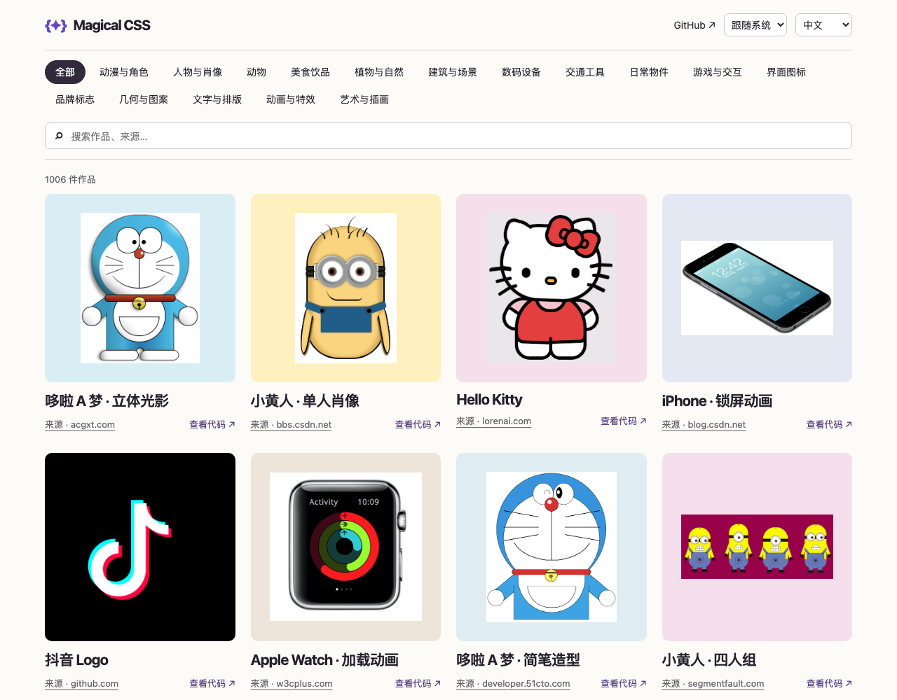
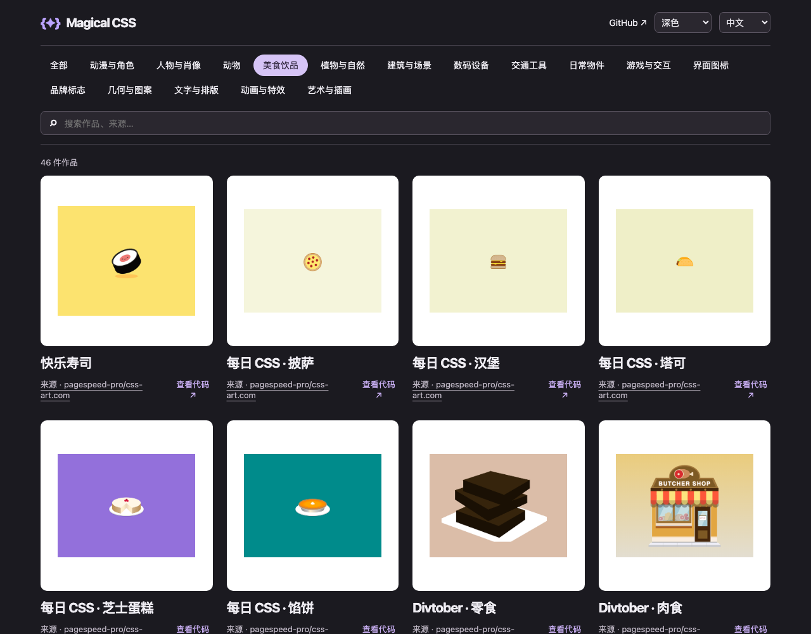
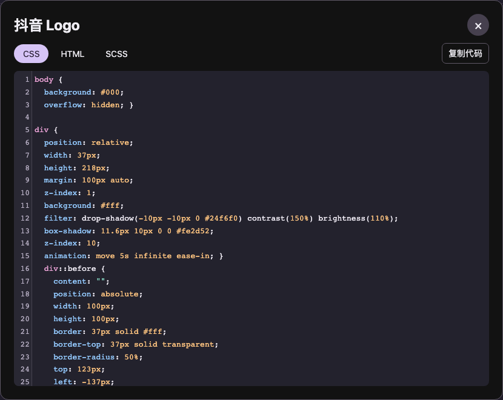

# Magical CSS

用 HTML 和 CSS 画出来的角色、设备、风景和日常物件。画廊收录了 1,006 件作品，可以按 16 个分类浏览，也可以搜索作品名称或来源。[打开在线画廊](https://merrier.github.io/Magical-CSS/)



点击分类可以缩小搜索范围。画廊提供中英文界面，支持浅色、深色和跟随系统三种主题。



点击作品封面或「查看代码」，可以对照阅读 HTML 和 CSS，部分作品还提供 SCSS 或 Less。「复制代码」会复制当前标签的完整源码。卡片下方的来源链接可以追溯原作或收录合集。



## 本地预览

在仓库根目录运行以下命令，然后在浏览器中打开 [本地画廊](http://127.0.0.1:8000/)。

```sh
python3 -m http.server 8000 --bind 127.0.0.1
```
